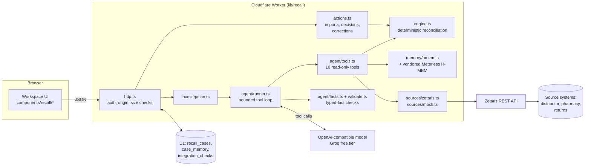
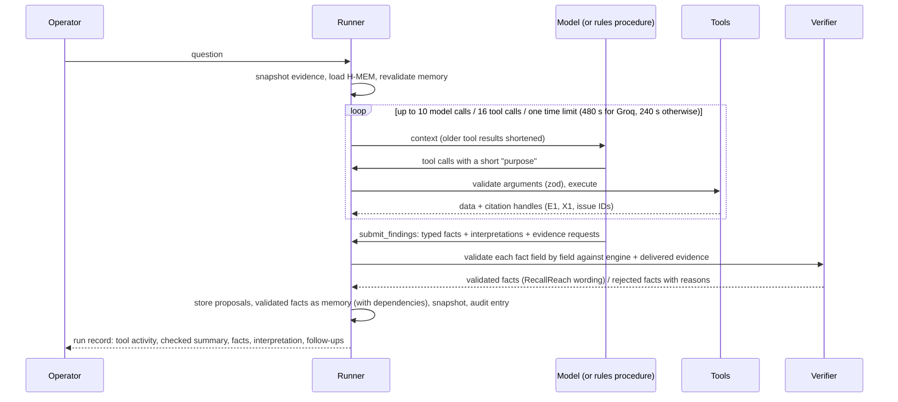

# Architecture and data flow

RecallReach is one web application: a React interface and a Cloudflare Worker API built with Vinext (the OpenAI Sites starter), with Cloudflare D1 (SQLite) for storage. Nothing else has to run for the core workflow. Zetaris and a language model are optional external services; Meterless H-MEM runs inside the Worker.



## Who owns what

| Concern | Owner | Never done by |
| --- | --- | --- |
| Stock arithmetic, identity matching, unit and chronology checks | `engine.ts` (deterministic, rules v2) | The language model; memory |
| Choosing what to look at next, explaining evidence | The language model (live mode) or `agent/rules.ts` (rules mode) | The engine |
| Whether a statement is supported | `agent/facts.ts`: each typed fact is checked field by field against the engine and the evidence delivered in that run; RecallReach writes the wording | The model's own say-so, or a second model |
| Approving follow-ups, correcting records | A signed-in person | The agent (no tool exists for it) |
| Remembering earlier conclusions and when they went stale | Meterless H-MEM plus RecallReach evidence fingerprints | Current-evidence calculations |

## Stock model

Each accepted shipment has one opening quantity, split into four mutually exclusive states:

`opening = available + quarantined + returned + dispensed`

A movement subtracts from one state and adds to another, so a bottle moved from quarantine to return stops counting as quarantined. A record is applied only if all of these hold:

1. It has an event ID and a shipment ID.
2. Its manufacturer, product and batch exactly match the case after trimming and case-folding. Similar batches (punctuation, O/0, I/1, a suffix letter) are flagged for a person and never counted.
3. Its quantity is a positive whole number ≤ 1,000,000, in the case unit. Nothing is ever converted.
4. It has a reference, a location and an ISO 8601 timestamp with a timezone, and is not in the future.
5. It is not a conflicting version of the same event ID; identical copies count once.
6. Its reference is not reused for the same shipment and movement under another event ID.
7. It has exactly one opening per shipment, and every movement comes after an accepted opening, at the same location, between supported states.
8. It does not release held stock or reverse dispensing; that needs a correction.
9. The source bucket holds enough stock for the movement.

Anything else stays visible with its reason and does not affect totals. Unconfirmed destinations, dispensed stock and near-miss batches each raise their own issue, which evidence can close only where that is meaningful. Dispensed stock always keeps its pharmacist follow-up.

## Investigation agent



- **Tools** (`agent/tools.ts`): read recall scope, run reconciliation, search records, open shipment ledger, retrieve original source row, trace a reference, recall memory, compare with the previous run, query a connected source through Zetaris, and propose a follow-up. All are read-only. `propose_follow_up` creates a draft that does nothing until a person approves it.
- **Arguments** are validated with zod schemas, which are also the JSON schemas sent to the model. Invalid, malformed or unknown calls are rejected, recorded and reported back to the model. After 3 consecutive turns of only invalid calls the run stops. A tool call the provider itself refuses as malformed (Groq `tool_use_failed`) is retried at a higher temperature: the first 3 per run without using the model-call budget, then each retry uses a model call.
- **Typed facts, not free text** (`agent/facts.ts`). The agent can only state a checkable fact in one of seven typed forms: `shipment_balance`, `case_total`, `record_report`, `record_status`, `open_issue`, `change_since_previous`, `source_row_report`. Each names an entity, a predicate, a quantity, a unit, a scope and (optionally) the evidence snapshot. The validator checks every field against the engine or the exact record: a quantity that is true for another shipment, the right number in the wrong state, a different unit, a case total presented as a shipment figure, an earlier snapshot, or evidence the agent never received each reject the fact with a specific reason. There is no regex extraction of numbers from prose and no second model acting as judge.
- **Wording is generated** from the validated fields, labelled *calculated by the engine* or *reported by a source, not proof of physical handling*. The **checked summary** is the list of validated statements. The model's own summary, its interpretations and its evidence requests are shown separately as unverified; overreaching phrases (recall complete, physically verified, destination confirmed, all stock contained, patient outcomes) are flagged there.
- **Delivered versus referenced.** Evidence counts as delivered only if it appears in the serialized tool result the model actually received (`collectDelivered`). Record handles that a memory or an issue list merely mentions are *referenced* and cannot support a fact until retrieved with `get_source_row`, `search_records` or `get_shipment_ledger`. Memory IDs are never evidence.
- **Tool output is always valid JSON.** Long results are shortened in passes (fewer items, shorter strings) with `<key>_omitted` counts and paging hints (`offset`, `next_offset`); items dropped are not delivered.
- **Evidence requests** must link to an open issue the agent retrieved. **Follow-up proposals** must name a retrieved issue and cite delivered evidence.
- **No hidden reasoning** is requested, stored or shown. The visible trace is the actual sequence of tool calls, each with the model's one-sentence stated purpose.
- **Rules mode** runs a fixed procedure that branches on the question and on tool results. It submits typed facts through the same executor and validator, and is labelled "no language model". It has its own tool-call limit (40) and the default 240 s time limit.
- **One deadline** covers model calls, retries, rate-limit waits and tools: 480 s for Groq live runs (its free tier spends most of a run waiting on rate limits), 240 s for other providers and for rules mode, or `AGENT_TIME_LIMIT_S` (60–900 s). Each run records the limits it ran under. One cancellation signal reaches every model request and connected-source query. No tool starts after the deadline, a rate-limit wait that would pass it ends the run, and a run is never reported *completed* after its deadline (tests use a fake clock).

- **Each request fits the provider's per-request ceiling** (`agent/budget.ts`; 8,000 tokens for Groq's free tier, which counts the prompt plus `max_tokens`). Tokens are estimated from text length and calibrated against what the provider reports. Results the model has already read become summaries first, then the output allowance shrinks, then older assistant text goes; results it has not yet read are summarised only as a last resort. Each result in a turn is capped so that all of that turn's results fit one request together. A refusal for size recalibrates the estimate, lowers the run's ceiling to the limit the provider states (or what the refusal implies) and resends a smaller request; an identical request is never resent. Evidence counts as delivered only once a request carrying it verbatim has been answered, so a result returned in the same turn as the answer cannot support it: a submission in the same turn as new results is sent back once so the model reads them first, and a result sent only as a summary is never resent in full and cannot support a fact.
- **A long run keeps its connection alive.** A live run's response starts at once and sends a space every 15 seconds (JSON allows leading whitespace); the saved result follows. Without this, a client that gives up when no response headers arrive within a few minutes (Firefox: 300 s over HTTP/1.1) would drop the request and the run would be lost. Because the status is then always 200, a failure is sent as `{ error, status }` in the body, which the client checks. A run is still lost if the tab is closed or the connection drops mid-run.

## Evidence Challenge ("Why this finding?")

`lib/recall/explain.ts` explains any validated fact or open issue from the case records, the engine's record statuses and the fact's typed fields: the statement and its snapshot, the evidence, the step-by-step calculation with the running balance, records not counted and why, what the evidence does not show, what evidence could change the conclusion, which evidence arrived since the previous run, why an approval does not change stock, and a clearly labelled hypothetical preview (the engine rerun with one synthetic containment record, nothing saved). No likelihoods are estimated.

## Memory dependencies and retention

Only validated facts and operator decisions are written to memory, in RecallReach's wording, with the dependencies the validator recorded: the case, a shipment, a record, or a connected-source row (instance, table, row key, content hash, capture time, query scope). Validity is recomputed on every read:

- **current**: every dependency was checked and is unchanged;
- **stale**: a dependency changed (a shipment's records or balance, a record's status, or a source row's content; or a complete read of the source no longer returned the row). Stale memories are superseded by a recheck note that quotes the old text;
- **unknown**: something cannot be checked here: no dependencies were recorded (older memories), or a connected-source row has not been read again since it was captured. Unknown is never shown as current.

Retention is bounded: the newest 200 memories and 800 ledger entries are kept per case. Older entries are dropped and the counts are stored and shown in the memory panel.

## Connected-source imports

An import is a **complete read** (`readAll`): a `COUNT(*)`, then keyset pages ordered by the source's timestamp column with `row_no` as the tie-breaker (bound as literals). The read succeeds only if the pages return exactly the counted number of distinct rows; a failed page, a repeated row or a count mismatch fails the whole read and nothing is imported. Each row's identity is source instance + table + row key, and its content is hashed: unchanged rows are skipped, a row changed at the source is imported as a new version that supersedes the old one through an audited correction (the old record is kept and no longer counted), a row the source no longer returns is reported but never reversed, and a read with no matching rows is a recorded, successful check. Every row read is recorded as an observation, which is what lets memory tell current connected-source evidence from evidence that has not been re-checked.


## Untrusted input

Imported files, connected-source rows and source text are treated as data:

- The system prompt instructs the model never to follow instructions inside records.
- `agent/safety.ts` flags instruction-like text (e.g. "ignore previous instructions", "system note", "recall complete") in tool output and in the evidence table.
- No tool can change balances, records or decisions, so an obeyed injection can at most produce a wrong *statement*, which the verifier labels (`tests/agent.test.ts` simulates exactly this).
- CSV exports prefix formula-leading cells (`= + - @` tab, CR). Markdown exports escape imported text.
- Upload limits: 800 KB and 2,000 rows per import, 500 characters per field, 5,000 records and 40 sources per case, 900 KB request bodies, 1.7 MB stored per case.

## Authentication and authorisation

- **Trust boundary.** RecallReach does not authenticate users itself. It reads `oai-authenticated-user-*` headers that the OpenAI Sites dispatcher sets after *Sign in with ChatGPT* and strips from client requests (`lib/recall/identity.ts`, used by `app/chatgpt-auth.ts`). Inside a Sites deployment those headers can be trusted; anywhere the Worker is reachable without that dispatcher in front (a `workers.dev` route, another proxy), a caller could forge them. See `DEPLOYMENT.md`.
- In local development the Vite plugin plays the dispatcher's role: it strips client-sent identity headers on every request and sets the local test user (`local_seedy`) only for loopback requests carrying its sign-in cookie. `tests/boundaries.test.ts` sends forged headers through it.
- Every case query filters by `owner_id = <signed-in user>`, including updates (`repo.ts`). A guessed case ID returns 404.
- Writes require JSON, reject cross-site origins and enforce size limits.

## Concurrency and persistence

- Each case is one JSON document in `recall_cases` with a `version`; its memory is a versioned row in `case_memory`.
- A change saves both **in one transaction** (a D1 batch): the case update is guarded by its version, the memory update by its version, both payloads carry a unique save token, and a final guard statement aborts the batch unless both rows now carry that token. Either both commit or neither does; a conflict on either returns HTTP 409, and the response is read back from storage after the commit.
- Evidence snapshots (`snapshot.ts`) store a 64-bit change-detection fingerprint and per-shipment balances at each run. They drive the staleness banner, `compare_with_previous_run`, and memory revalidation. The fingerprint detects change only; it is not a security hash.

## Audit trail

Every change appends an entry whose SHA-256 hash covers the previous entry's hash. **Verify hash chain** recomputes the chain. This shows the history is internally consistent; it does not make storage tamper-proof, because someone with database access could rewrite the whole chain.

## Files

```
app/                 pages and API routes (cases, export, integrations)
components/recall/   workspace, agent panel, integrations, record dialog
lib/recall/          engine, csv, snapshot, audit, actions, http, repo, export, investigation
lib/recall/agent/    tools, runner, rules, facts (typed-fact validator), validate, provider, budget (request size), safety
lib/recall/explain.ts  Evidence Challenge
lib/recall/memory/   H-MEM adapter
lib/recall/sources/  Zetaris adapter, mock, shared mapping
vendor/meterless-hmem/  unmodified Meterless H-MEM reference (Apache-2.0)
drizzle/             D1 migrations
integrations/zetaris/   fixture source databases for a local Zetaris
scripts/             evaluate, migrate-local, zetaris-fixtures, starter tooling
tests/               node:test suites (engine, agent, facts, trust, import, boundaries, explain, memory, http, zetaris)
eval/heldout/        held-out fixture and answer key, committed before any run
```
