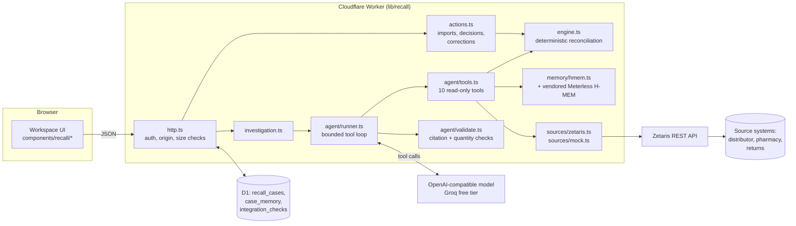
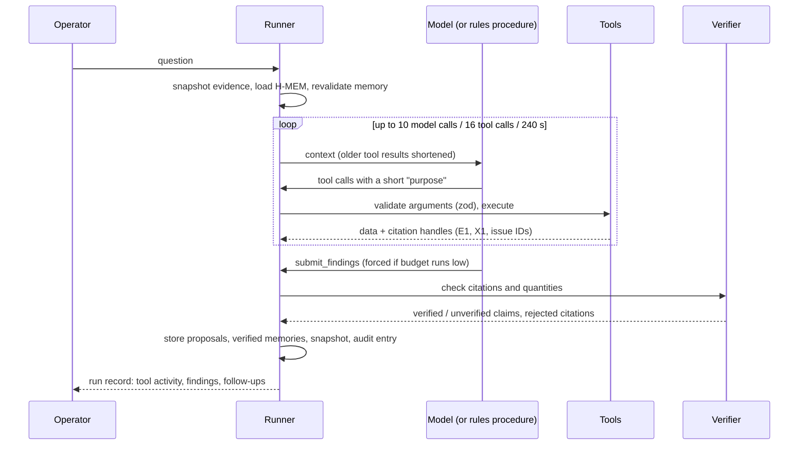

# Architecture and data flow

RecallReach is one web application: a React interface and a Cloudflare Worker API built with Vinext (the OpenAI Sites starter), with Cloudflare D1 (SQLite) for storage. Nothing else has to run for the core workflow. Zetaris and a language model are optional external services; Meterless H-MEM runs inside the Worker.



## Who owns what

| Concern | Owner | Never done by |
| --- | --- | --- |
| Stock arithmetic, identity matching, unit and chronology checks | `engine.ts` (deterministic, rules v2) | The language model; memory |
| Choosing what to look at next, explaining evidence | The language model (live mode) or `agent/rules.ts` (rules mode) | The engine |
| Whether a claim is supported | `agent/validate.ts` against what the run actually retrieved | The model's own say-so |
| Approving follow-ups, correcting records | A signed-in person | The agent (no tool exists for it) |
| Remembering earlier conclusions and when they went stale | Meterless H-MEM plus RecallReach evidence fingerprints | Current-evidence calculations |

## Stock model

Each accepted shipment has one opening quantity, split into four mutually exclusive states:

`opening = available + quarantined + returned + dispensed`

A movement subtracts from one state and adds to another, so a bottle moved from quarantine to return stops counting as quarantined. A record is applied only if all of these hold:

1. It has an event ID and a shipment ID.
2. Its manufacturer, product and batch exactly match the case after trimming and case-folding. Similar batches (punctuation, O/0, I/1, a suffix letter) are flagged for a person and never counted.
3. Its quantity is a positive whole number ≤ 1,000,000, in the case unit. Nothing is ever converted.
4. It has a reference, a location and an ISO 8601 timestamp with a timezone, and is not in the future.
5. It is not a conflicting version of the same event ID; identical copies count once.
6. Its reference is not reused for the same shipment and movement under another event ID.
7. It has exactly one opening per shipment, and every movement comes after an accepted opening, at the same location, between supported states.
8. It does not release held stock or reverse dispensing; that needs a correction.
9. The source bucket holds enough stock for the movement.

Anything else stays visible with its reason and does not affect totals. Unconfirmed destinations, dispensed stock and near-miss batches each raise their own issue, which evidence can close only where that is meaningful. Dispensed stock always keeps its pharmacist follow-up.

## Investigation agent



- **Tools** (`agent/tools.ts`): read recall scope, run reconciliation, search records, open shipment ledger, retrieve original source row, trace a reference, recall memory, compare with the previous run, query a connected source through Zetaris, and propose a follow-up. All are read-only. `propose_follow_up` creates a draft that does nothing until a person approves it.
- **Arguments** are validated with zod schemas, which are also the JSON schemas sent to the model. Invalid, malformed or unknown calls are rejected, recorded and reported back to the model. After 3 consecutive turns of only invalid calls the run stops.
- **Citations** are short per-run handles (`E7`) mapped to record IDs. A claim is *verified* only if every citation was returned by a tool in this run, every quantity it states matches a retrieved record or engine figure, and it does not claim something RecallReach cannot establish (recall complete, physically verified, destination confirmed, all stock contained, patient outcomes). Unsupported claims are kept but labelled *unverified* with the reasons. Only verified statements are written to memory.
- **No hidden reasoning** is requested, stored or shown. The visible trace is the actual sequence of tool calls, each with the model's one-sentence stated purpose.
- **Rules mode** runs a fixed procedure that branches on the question and on tool results. It uses the same executor and verifier, and is labelled "no language model".

## Untrusted input

Imported files, connected-source rows and source text are treated as data:

- The system prompt instructs the model never to follow instructions inside records.
- `agent/safety.ts` flags instruction-like text (e.g. "ignore previous instructions", "system note", "recall complete") in tool output and in the evidence table.
- No tool can change balances, records or decisions, so an obeyed injection can at most produce a wrong *statement*, which the verifier labels (`tests/agent.test.ts` simulates exactly this).
- CSV exports prefix formula-leading cells (`= + - @` tab, CR). Markdown exports escape imported text.
- Upload limits: 800 KB and 2,000 rows per import, 500 characters per field, 5,000 records and 40 sources per case, 900 KB request bodies, 1.7 MB stored per case.

## Authentication and authorisation

- Identity comes from the OpenAI Sites dispatcher, which injects `oai-authenticated-user-*` headers after *Sign in with ChatGPT* (`app/chatgpt-auth.ts`).
- Every case query filters by `owner_id = <signed-in user>`, including updates (`repo.ts`). A guessed case ID returns 404.
- Writes require JSON, reject cross-site origins and enforce size limits.
- The development sign-in (`local_seedy`) exists only in the Vite dev-server plugin, only answers loopback requests, and is not part of production builds.
- **Important:** the header-based identity is only safe behind the Sites dispatcher, which strips and sets those headers. Deploying the Worker anywhere else (for example plain `wrangler deploy`) would let a caller forge them. See `DEPLOYMENT.md`.

## Concurrency and persistence

- Each case is one JSON document in `recall_cases` with a `version`. Every update is `UPDATE … WHERE id = ? AND owner_id = ? AND version = ?`; a stale writer gets HTTP 409 and must reload.
- Memory has its own versioned row in `case_memory`. It is written after the case and is not atomic with it; if the memory write loses a race, the response says `memory_saved: false` and the case is still correct.
- Evidence snapshots (`snapshot.ts`) store a 64-bit change-detection fingerprint and per-shipment balances at each run. They drive the staleness banner, `compare_with_previous_run`, and memory revalidation. The fingerprint detects change only; it is not a security hash.

## Audit trail

Every change appends an entry whose SHA-256 hash covers the previous entry's hash. **Verify hash chain** recomputes the chain. This shows the history is internally consistent; it does not make storage tamper-proof, because someone with database access could rewrite the whole chain.

## Files

```
app/                 pages and API routes (cases, export, integrations)
components/recall/   workspace, agent panel, integrations, record dialog
lib/recall/          engine, csv, snapshot, audit, actions, http, repo, export, investigation
lib/recall/agent/    tools, runner, rules, validate, provider, safety
lib/recall/memory/   H-MEM adapter
lib/recall/sources/  Zetaris adapter, mock, shared mapping
vendor/meterless-hmem/  unmodified Meterless H-MEM reference (Apache-2.0)
drizzle/             D1 migrations
integrations/zetaris/   fixture source databases for a local Zetaris
scripts/             evaluate, migrate-local, zetaris-fixtures, starter tooling
tests/               node:test suites (engine, agent, memory, http, zetaris)
```
